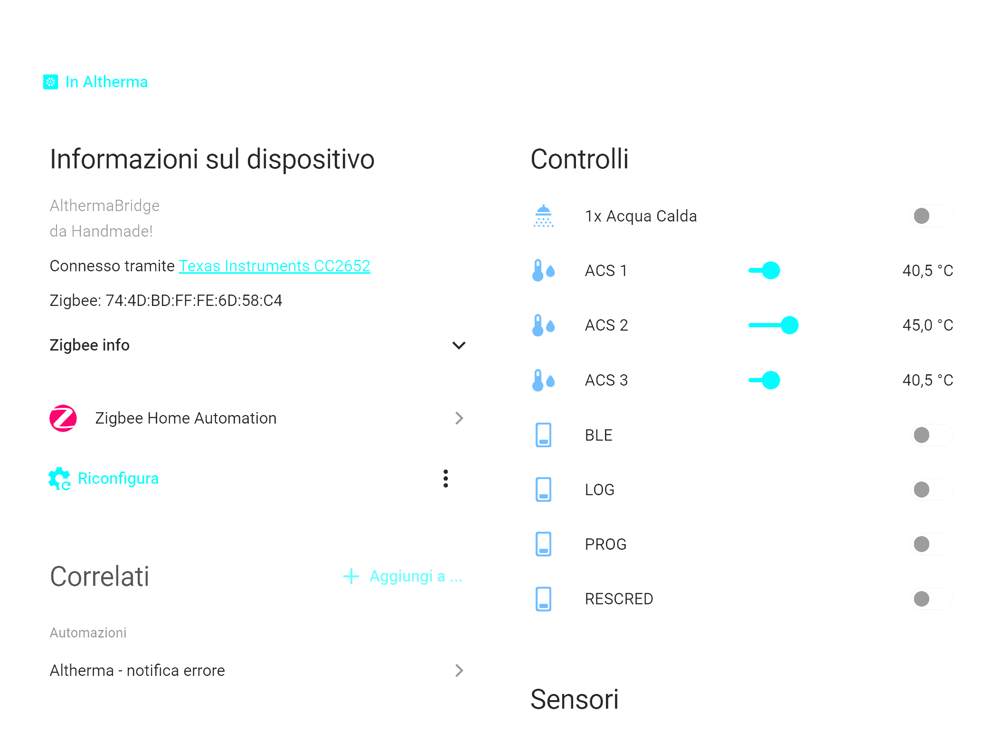
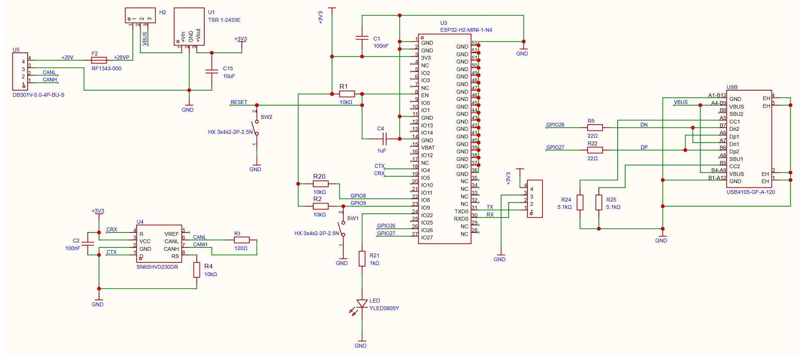
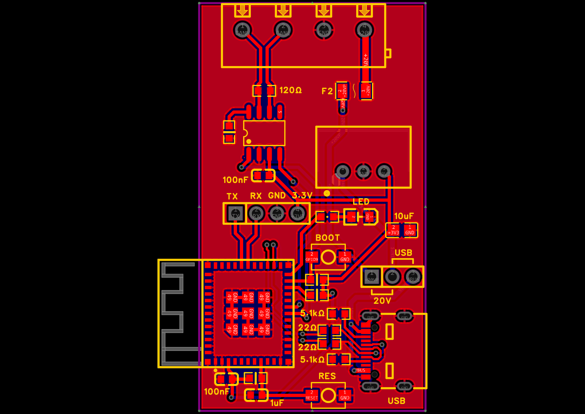

# Daikin Altherma (RoCon) — Zigbee bridge (ESP32-H2)

A bridge between the **RoCon CAN bus** of a Daikin Altherma heat pump (EHSX08P30BB with the
Rotex RoCon B1 control panel) and **Home Assistant (ZHA)** over Zigbee, built on an **ESP32-H2**.
It reads the heat pump parameters over CAN, exposes the useful ones as standard Zigbee
entities, lets Home Assistant change the domestic hot water (DHW) settings, and keeps the RoCon
clock in sync with Home Assistant.



## Features

- **Reads 106 RoCon parameters** in a round-robin poll over CAN (one request every 250 ms).
- **Exposed to Home Assistant**: DHW tank temperature, water pressure, error code, operating
  mode (DHW / heating / cooling / defrost).
- **Writable from Home Assistant**: "1x hot water" (one-shot DHW boost) and the three DHW
  setpoints (35–70 °C, 0.5 °C steps).
- **Clock sync**: reads the local time from the Zigbee coordinator (DST included) at start-up
  and every day at 03:30, and corrects the RoCon date and time when they differ by more than
  2 minutes. Writing the RoCon clock is not documented by the projects listed in
  [Credits](#credits): the commands were captured on the bus while setting the clock from the panel.
- **Maintenance switches** in Home Assistant: firmware update over Bluetooth, serial download
  mode, Zigbee factory reset, live log over Bluetooth (see [Maintenance switches](#maintenance-switches)).
- Only a curated list of parameters can be written; every other parameter is read-only in the
  firmware, even if the RoCon accepts writes.
- **Zigbee router**, joins a network on any channel (11–26).

## Repository layout

| Path | Content |
|---|---|
| `firmware/` | ESP-IDF project (ESP32-H2) |
| `firmware/main/` | `main.c` (CAN polling task), `can_bus.c` (TWAI driver), `rocon_params.c` + `rocon_table.h` (parameter table, decode, write builder), `zigbee.c` (Zigbee/ZHA), `timesync.c` (RoCon clock), `ble_update.c`, `ble_log.c`, `maint.c` (maintenance), `led.c` |
| `firmware/tools/gen_rocon_table.py` | Generates `rocon_table.h` from the parameter list of the Trunks1982 project |
| `tools/` | Web pages for Bluetooth update and Bluetooth log (`ble_update.html`, `ble_log.html`) |
| `ha/` | ZHA quirk (`altherma_quirk.py`) and Home Assistant screenshot |
| `hardware/` | EasyEDA Pro schematic and PCB (`.epro2`), schematic and PCB images |
| `binaries/` | Ready-to-flash firmware (see [Flashing without ESP-IDF](#flashing-without-esp-idf)) |

## Hardware



| PCB |
|---|
|  |

The design files `hardware/Schematic.epro2` and `hardware/PCB.epro2` are **EasyEDA Pro** projects:
open them with EasyEDA Pro (desktop app or the web editor at [pro.easyeda.com](https://pro.easyeda.com)).
`hardware/Schematic.png` is an export of the schematic and `hardware/PCB.webp` a view of the
PCB layout, for quick viewing.

The bridge plugs into connector **J13** of the RoCon BM1 board, which carries the CAN bus and a
+20 V supply.

> **Safety:** the heat pump is mains powered. Switch the whole system off before opening it
> and connecting the bridge.

### Mounting on J13

U5 mates with the original J13 connector **rotated by 180°**. Inside the heat pump the
connectors face so that their cables leave towards the inside of the unit; turned the other
way round, the plug still fits, and the PCB sits right in front of the connector, out of the way.

### Connector to the RoCon — U5 (DB301V-5.0-4P)

| U5 pin | Signal |
|---|---|
| 4 | +20 V (from the RoCon) |
| 3 | GND |
| 2 | CAN L |
| 1 | CAN H |

### Power — jumper H2

The bridge can be powered either by the heat pump or by USB, selected with the jumper on H2
(marked **20V** and **USB** on the PCB):

| Jumper | Power source |
|---|---|
| H2 1–2 (**20V**) | +20 V from the RoCon (U5 pin 4, through fuse F2) |
| H2 2–3 (**USB**) | VBUS of the USB-C connector |

H2 pin 2 feeds the input of the DC/DC converter U1. With the jumper on **20V**, the USB-C
connector can still be used for flashing and logs: its VBUS is then not connected.

### Main parts

| Ref | Part | Function |
|---|---|---|
| U3 | ESP32-H2-MINI-1-N4 | MCU, Zigbee and Bluetooth LE, 4 MB flash |
| U4 | SN65HVD230DR | 3.3 V CAN transceiver (RS to GND through R4 10 kΩ) |
| U1 | TSR 1-2433E | DC/DC converter, input from H2 (+20 V or USB 5 V) → 3.3 V |
| H2 | 3-pin header + jumper | Power source selection (20V / USB) |
| F2 | RF1343-000 | Resettable fuse on the +20 V input |
| R3 | 120 Ω | CAN termination between CAN H and CAN L |
| USB | USB4105-GF-A-120 | USB-C: ESP32-H2 native USB (flashing and logs), optional power through H2 |
| SW1 | push button | BOOT (GPIO9): factory reset / download mode |
| SW2 | push button | RESET (EN) |
| LED | yellow LED + R21 1 kΩ | Status LED (GPIO22) |

Header H1 (4 pins): 1 TX, 2 RX, 3 GND, 4 3.3 V — UART0 serial console.

### GPIO map

| GPIO | Function |
|---|---|
| 4 | CAN TX → SN65HVD230 D |
| 5 | CAN RX ← SN65HVD230 R |
| 9 | BOOT button (10 kΩ pull-up) |
| 8 | 10 kΩ pull-up (strapping pin) |
| 22 | Status LED |
| 26 / 27 | USB D− / D+ |
| TXD0 / RXD0 | Serial console (header) |

## Status LED

| Pattern | Meaning |
|---|---|
| Fast blink (100 ms) | Starting |
| Double blink every 2 s | Searching for a Zigbee network |
| Single blink every 5 s | Operational |
| Slow blink (500 ms on/off) | Bluetooth update mode |
| 3 fast blinks every 3 s | CAN bus not working, or no frame received for 10 s |
| Steady on | Factory reset in progress |

## Zigbee endpoints (ZHA)

Manufacturer `Handmade!`, model `AlthermaBridge`, router. Joins a network on any channel (11–26).

| EP | Cluster | RoCon parameter | Home Assistant |
|---|---|---|---|
| 1 | On/Off | `1_dhw` | Switch "1x hot water" (one-shot DHW boost) |
| 2 | Analog Output | `target_hot_water_temperature_1` | Number, DHW setpoint 1 (35–70 °C) |
| 3 | Analog Output | `target_hot_water_temperature_2` | Number, DHW setpoint 2 (35–70 °C) |
| 4 | Analog Output | `target_hot_water_temperature_3` | Number, DHW setpoint 3 (35–70 °C) |
| 5 | Temperature Measurement | `tdhw1` | DHW tank temperature |
| 6 | Analog Input | `water_pressure` | Water pressure (bar) |
| 7 | Analog Input | `error_code` | RoCon error code |
| 8 | Binary Input | `mode_of_operating` = 4 | DHW production active |
| 9 | Binary Input | `mode_of_operating` = 1 | Heating active |
| 10 | Binary Input | `mode_of_operating` = 2 | Cooling active |
| 11 | Binary Input | `mode_of_operating` = 3 | Defrost active |
| 20 | On/Off | — | BLE (maintenance) |
| 21 | On/Off | — | PROG (maintenance) |
| 22 | On/Off | — | RESCRED (maintenance) |
| 23 | On/Off | — | LOG (maintenance) |

EP1 also has a **Time** cluster client, used to read the local time from the coordinator for
the clock sync. The names of EP2–11 come from the ZCL `description` attribute; the quirk in
`ha/` names the maintenance switches EP20–23.

The three DHW setpoints are the three switching cycles of the RoCon DHW time program.

### ZHA quirk

`ha/altherma_quirk.py` gives the names BLE, PROG, RESCRED and LOG to EP20–23. Copy it into
your custom quirks folder (`zha: custom_quirks_path:` in `configuration.yaml`) and restart
Home Assistant. Without the quirk the device works the same; the four switches only have
generic names.

## Maintenance switches

Four virtual switches let you maintain the bridge from Home Assistant, without opening the
heat pump. Each action starts 1.5 s after the command, so that the Zigbee reply is sent first.

| Switch | EP | What it does |
|---|---|---|
| **BLE** | 20 | Restarts in **Bluetooth update mode**: Zigbee and CAN are not started, only Bluetooth LE for 10 minutes, then the bridge restarts normally. Use it with `tools/ble_update.html`. |
| **PROG** | 21 | Restarts in **serial download mode** (ROM bootloader), ready for `esptool` over USB. |
| **RESCRED** | 22 | **Zigbee factory reset**: erases the Zigbee credentials and restarts; the bridge must be paired again. Same as holding BOOT for 5 s. |
| **LOG** | 23 | **Log over Bluetooth**: ON starts Bluetooth LE next to Zigbee and sends the firmware log to `tools/ble_log.html`; it stays on after restarts until it is switched OFF (or BOOT is pressed briefly, 0.3–5 s). Switching it on or off restarts the bridge. |

After every restart the bridge reports the real state of these switches to Home Assistant, so
they do not stay ON in the UI.

### Bluetooth web pages

The pages in `tools/` use **Web Bluetooth**: open them in **Chrome or Edge** (desktop or Android),
directly from disk or from any web server. Firefox and Brave do not support Web Bluetooth.

**Firmware update — `tools/ble_update.html`**

1. Turn on the **BLE** switch in Home Assistant. The LED starts blinking slowly; you have
   10 minutes.
2. Open `ble_update.html`, click **Choose the .bin file…** and choose the application image
   (`altherma_bridge.bin`, the same file flashed at `0x20000`).
3. Click **Find device and send** and pick the device named `Altherma-XXXX`.
4. At the end the image is verified and the bridge restarts with the new firmware, still paired.

The bridge refuses images of another project (the project name inside the image must match)
and images larger than the OTA partition (1.5 MB). Option: **Erase the Zigbee credentials at the
end** (the bridge must then be paired again). The **Erase Zigbee credentials** button erases them
without updating.

**Live log — `tools/ble_log.html`**

1. Turn on the **LOG** switch in Home Assistant (the bridge restarts).
2. Open `ble_log.html`, click **Connect device** and pick `AlthermaLog-XXXX`.
3. The log is shown live and the page reconnects by itself after a restart. **Save .txt**
   downloads everything received; the filter shows only lines containing the given words.
4. Turn **LOG** off when you are done (or press BOOT briefly).

The log is also available on the serial console (UART0 header and USB). On the UART0 console you
can type `prog` (download mode), `reset` (restart) or `help`.

## RoCon CAN bus — what matters

- **20 kbit/s, triple sampling**, standard 11-bit IDs.
- The bridge sends its requests with CAN ID **0x680** (the same ID used by the Trunks1982 ESPHome
  component); the replies come from ID **0x180**. The RoCon panel itself uses ID 0x10A, so the bus
  is shared by several masters: the bridge only adds its own requests.
- Read request: `31 00 FA xx yy 00 00`; write: `30 00 FA xx yy` + value. The parameter table
  (index, value offset and size, scale) is generated from the Trunks1982 project by
  `firmware/tools/gen_rocon_table.py`.
- Clock: day, month, year (2 digits), hour and minute are written with `30 00 FA 01 22..26 VV 00`.
  Frames must be spaced (the bridge waits 100 ms): with 10 ms between frames one was lost. The
  bridge reads the values back to verify them and retries up to 3 times.
- After a write from Home Assistant, readings that still carry the old value are ignored for
  30 s, because the RoCon can keep answering with the previous value for a few seconds.

## Building

- **ESP-IDF v5.5.6**, target `esp32h2`.
- **esp-zigbee-lib 2.0.5** (no ZBOSS) through its 1.x compatibility layer
  (`CONFIG_ZB_SDK_1xx=y`), NimBLE for Bluetooth LE. Components are downloaded by the IDF
  Component Manager.

From an ESP-IDF terminal, in `firmware/`:

```
idf.py set-target esp32h2
idf.py -p COMx build flash monitor
```

`sdkconfig` is generated from `sdkconfig.defaults`. Zigbee OTA is not available in the
esp-zigbee-lib 2.0.5 compatibility layer: updates are done over USB or Bluetooth.

## Flashing without ESP-IDF

The `binaries/` folder contains the firmware built with ESP-IDF 5.5.6 and esp-zigbee-lib 2.0.5,
flashed through the bridge's USB-C connector (ESP32-H2 native USB, no USB-serial adapter needed).
Checksums are in `binaries/SHA256SUMS.txt`.

| File | Offset | Use |
|---|---|---|
| `altherma-bridge-full.bin` | `0x0` | **First installation**: bootloader + partition table + app in one file |
| `bootloader.bin` | `0x0` | Separate parts (same content as the full image) |
| `partition-table.bin` | `0x8000` | |
| `ota_data_initial.bin` | `0x10000` | |
| `altherma_bridge.bin` | `0x20000` | **Update** of a bridge that is already installed (application only); also the file for the Bluetooth update |

> **Note:** the full image also overwrites the `nvs` area, so the Zigbee pairing is erased:
> the bridge must be paired again in ZHA. To update a bridge that is already working, flash
> only `altherma_bridge.bin` at `0x20000`, or use the Bluetooth update.

**Option 1 — browser (Chrome or Edge, no installation)**

1. Open [ESP Tool (esptool-js)](https://espressif.github.io/esptool-js/) and click **Connect**,
   choosing the bridge's USB port.
2. Add the file and its offset from the table above (`altherma-bridge-full.bin` at `0x0`
   for a first installation).
3. Click **Program**, then reset the bridge.

**Option 2 — esptool (Python)**

```
pip install esptool
esptool.py --chip esp32h2 --port COMx write_flash 0x0 altherma-bridge-full.bin
```

Update only:

```
esptool.py --chip esp32h2 --port COMx write_flash 0x20000 altherma_bridge.bin
```

If the board does not enter download mode automatically, use the **PROG** switch in Home
Assistant, or hold BOOT (GPIO9) while pressing RESET.

## Pairing with Home Assistant (ZHA)

1. In ZHA choose **Add device** (permit join).
2. Power the bridge: when it is not in a network it searches automatically (LED double blink);
   once joined and the coordinator answers, the LED blinks once every 5 s.
3. Optional: install the quirk from `ha/` to name the maintenance switches.

Factory reset (leave the Zigbee network): hold BOOT (GPIO9) for 5 seconds, or use the
**RESCRED** switch.

A bridge that was running a firmware based on esp-zigbee-lib 1.x keeps its pairing: the Zigbee
data is migrated once at the first start with `esp_zigbee_nvram_migrate()`.

## Credits

- [Trunks1982/Daikin-Rotex-HPSU-CAN-Seriell](https://github.com/Trunks1982/Daikin-Rotex-HPSU-CAN-Seriell)
  (MIT) — RoCon parameter list (CAN commands, offsets, scales), used to generate `rocon_table.h`.
- [Spanni26/pyHPSU](https://github.com/Spanni26/pyHPSU) — bus bitrate and CAN IDs.

## License

MIT — see [LICENSE](LICENSE).
